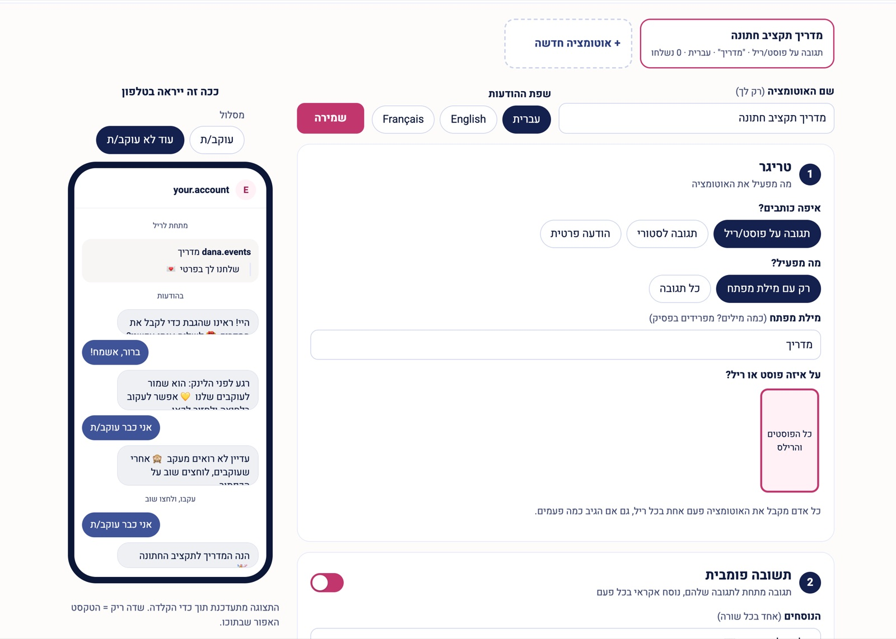

# Instagram comment-to-DM bot and post publisher

A self-hosted alternative to ManyChat-style tools: someone comments a keyword on your post, and they get your link in a DM. It also publishes and schedules posts.
It runs on Meta's official Instagram API as one Cloudflare Worker, with no servers and nothing third-party in your DMs; it fits in Cloudflare's free tier.
Built by [Eventimio](https://eventimio.ai) for [@eventimio.ai](https://www.instagram.com/eventimio.ai/), and shared as is.



**Setup:** [SETUP.md](SETUP.md) (about an hour, mostly in Meta's dashboards). **For the people who write the automations (Hebrew):** [GUIDE.he.md](GUIDE.he.md).

## What it does

- **DM automations:** a comment, story reply or DM with a keyword (or any comment on a post) gets a private reply with a link.
  Optional opener message with a button, followers-only gate, public reply variants, one language per automation (he/en/fr).
- **Posts:** upload 1–10 images (carousel), caption, publish now or schedule (Israel time), and optionally attach a DM automation to the new post.
  Capped at `MAX_POSTS_PER_DAY` (10).
- **Admin:** Hebrew, RTL, with a live phone preview. Your brand: `BRAND_NAME`, plus an optional `BRAND_LOGO` and `BRAND_ICON`. Behind Cloudflare Zero Trust (recommended: the Worker also verifies the Access JWT, so it stays closed even if the Access policy is removed) or a password.

## Architecture

| Piece | Where |
|---|---|
| Worker routes and the 5-minute cron | `src/index.js` |
| Webhook: handshake, signature, event parsing | `src/webhook.js` |
| DM pipeline: ingest → hourly budget → deliver → settle | `src/outbox.js` |
| D1 reads and writes for settings and automations | `src/store.js` |
| Meta Graph API calls (`graph.facebook.com`, Unified login) | `src/meta.js` |
| DM flow (opener → follow gate → link) | `src/flow.js`, `src/match.js`, `src/rules.js` |
| Publishing (R2 staging → container → status → `media_publish`) | `src/posts.js` (pure), `src/publisher.js` (I/O) |
| Admin pages | `src/layout.js`, `src/admin.js`, `src/postpage.js`, `public/admin.css`, `public/admin.js` |
| Legal pages Meta links to (self-contained, no /public assets) | `src/pages.js` |
| Zero Trust JWT check | `src/access.js` |
| Data | D1 `instagram-dm` (`migrations/`, applied with `wrangler d1 migrations apply`), R2 `instagram-dm-media` |

### Meta in one paragraph

New Meta apps get **Facebook Login for Business** only, so all calls go to `graph.facebook.com`. Tokens come from a business-portfolio system user and never expire: `IG_ACCESS_TOKEN` for messages and comments, and a separate `IG_PUBLISH_TOKEN` for posting, so the reply token can't post. Webhooks: `comments`, `messages`, `messaging_postbacks`.

**The catch:** until your app passes **App Review**, Meta only delivers comments from accounts that have a role on the app. Plan for it before you rely on the bot for real followers.

## Develop

```bash
npm install
npm test            # node:test, incl. Worker integration tests on node:sqlite (no network)
cp wrangler.example.toml wrangler.toml   # then fill it in (gitignored)
npx wrangler dev    # local; needs .dev.vars (ADMIN_PASSWORD, VERIFY_TOKEN, IG_APP_SECRET)
npx wrangler deploy
```

With `ACCESS_AUD` empty the admin uses Basic auth with `ADMIN_PASSWORD`. Secrets live in Worker secrets (and `.dev.vars` locally), never in the repo.

## Operations

**Cron (every 5 min):** drains the DM queue (max `MAX_PER_HOUR`, at most 25 Graph calls per run, failed sends retried after 1 and then 4 minutes), publishes one due post, and recovers stuck ones. Once an hour it also purges old data (DM log after 90 days, staged images 7 days after publish).

**Schema changes:** add a numbered file to `migrations/`, additive only (old and new Worker versions overlap during a deploy), apply it with `npx wrangler d1 migrations apply instagram-dm --remote` *before* deploying the code that needs it.

**Post lifecycle:** `scheduled` → `publishing` → `processing` (Meta still preparing) → `published` / `failed`.
- **"Publish now" isn't instant:** a large carousel can take ~5–10 minutes, because Meta processes each image and the cron re-checks every 5 minutes.
- **Interrupted runs:** a run killed mid-publish goes back to the queue after 5 minutes.
- **No double posts:** a container already `PUBLISHED` is recorded, never published again.
- Scheduling is ours: Meta has no "publish at", and containers expire after 24h.

**Checking what's going on:**

```bash
npx wrangler tail instagram-dm --format pretty    # live requests and cron runs
npx wrangler d1 execute instagram-dm --remote --command "SELECT id,status,error,permalink FROM posts ORDER BY id DESC LIMIT 5"
npx wrangler d1 execute instagram-dm --remote --command "SELECT source,status,error,username FROM sends ORDER BY created_at DESC LIMIT 10"
```

**Gotchas we hit:**
- **Zero Trust email code:** Access matches the email exactly. A phone that auto-capitalises the first letter gets "account does not have access".
- **Background time limit:** work after a response has ~30s. Carousel child containers are therefore created in parallel.
- **Tokens:** generate them from a portfolio system user, not the app dashboard (see [SETUP.md](SETUP.md) step 4).

## Front-end standards

No framework and no build step: server-rendered HTML with a little progressive enhancement.

- **Security headers** on every page: a strict CSP with a fresh nonce per response (no `unsafe-inline`), `nosniff`, `frame-ancestors 'none'` and a referrer policy. Inline `style=""` attributes are not allowed; styles live in `public/*.css`.
- **Native UI:** confirmations are `<dialog>` elements opened with Invoker Commands (`command="show-modal"`), switches carry the `switch` attribute, and validation shows with `:user-invalid` while keeping `aria-invalid` in sync. `public/admin.js` adds fallbacks for browsers that lack these.
- **Layout:** logical properties for RTL, and container queries so each editor card adapts to its own width.
- **Font:** self-hosted Heebo variable font (SIL OFL 1.1, `public/fonts/OFL-Heebo.txt`), split into Hebrew and Latin files loaded by `unicode-range`, with `font-size-adjust: from-font` to limit layout shift during the swap.

## License

MIT, see [LICENSE](LICENSE). Heebo is under the SIL Open Font License (`public/fonts/OFL-Heebo.txt`).
Not affiliated with Meta. Meta can change its rules or restrict your app at any time; you are responsible for using the API within its terms.
